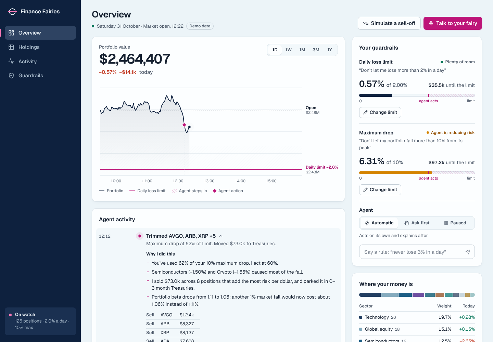

# Finance Fairies: Portfolio Guardian

An agentic portfolio guardian. You set two rules for the whole portfolio in plain language, "never fall more than 10% from where I started" and "never lose more than 2% in a day", and the agent keeps the portfolio inside them. When risk builds up it **rotates** money from the riskiest holdings into calmer assets instead of selling everything to cash, then explains, by text or voice, why the market moved and what it did.

Built at *Halloween at Imperial: Gemini Edition* (Track 1, Frontier Agents with Gemini). All trading is simulated on a paper portfolio.



## How it decides

**The LLM proposes, the code disposes.**

1. Every daily close, the **engine** (Python, deterministic) measures risk: drawdown against your limits, a 99% one-day VaR budget, shock days, volatility spikes, and a CAPM split of the day's move into market and stock-specific parts.
2. When a line is crossed, the engine builds its own rotation plan, and the **Gemini agent** (Gemini 4 Argon) reads the same numbers through tools, proposes a plan, and must pass `check_plan` before it can submit. With live news on, Gemini also reads a Google-Search-grounded brief and cites its sources.
3. The engine re-checks every plan (volatility, CVaR, stress tests, position and sector caps, turnover, cost, VaR) and keeps the best one that passes.
4. **Approval routing**: small, pre-approved trades run automatically; large legs, new assets, hedges, or a plan the agent disagrees with wait for your click. Paused mode trades nothing.
5. Orders fill at the next open with slippage and costs.

Other providers (OpenAI, Anthropic, OpenRouter) can be selected in Settings; Gemini is the default.

## Repository layout

| Path | What it is |
|---|---|
| [`engine/`](engine/README.md) | **Backend.** Risk engine, replay simulator, Gemini agent and FastAPI (`engine/API.md` is the frontend contract) |
| `src/`, `server/` | **Web interface** (Vite + React + TypeScript) |
| `design/`, `DESIGN.md`, `PRODUCT.md` | Design system, product brief, clickable build |
| `engine.py`, `api.py`, `models.py`, `test_*.py` (root) | First quant prototype and hedging tests, kept for reference: [docs/quant-prototype.md](docs/quant-prototype.md) |

## Quickstart

Backend (Python 3.12, [uv](https://docs.astral.sh/uv/)):

```bash
cd engine
uv sync
bash scripts/set_gemini_key.sh          # stores GEMINI_API_KEY in engine/.env.local (git-ignored) and checks it
uv run --project . pytest -q            # 18 tests
uv run --project . uvicorn guardian.api:app --port 8000
```

Web interface (Node 20+):

```bash
npm install
npm run dev                              # http://localhost:5173, looks for the engine at http://localhost:8000
```

Without the engine the interface still runs on its built-in simulation.

## Results on real data (replay, simulated fills)

Limits 10% maximum drawdown and 2% daily loss, seven equal-weight AI and tech stocks, 2 January to 14 March 2025 (includes the DeepSeek sell-off):

| Strategy | Return | Max drawdown | Days worse than -2% |
|---|---|---|---|
| Buy and hold | -10.3% | 18.1% | 10 |
| Sell everything on first alarm | +3.5% | 0.0% | 0 (out of the market from 3 January) |
| **Guardian** | **+0.2%** | **7.2%** | **0** |

Guardian stayed invested and inside both limits; its worst day was -1.88%. On a mixed stock and crypto book (September 2025 to October 2026) it returned +16.6% against +36.2% for buy and hold, with a 10.5% instead of 23.1% maximum drawdown: it gives up upside to keep the limits. Thresholds are heuristics from our research, not calibrated by backtest, and limits are targets rather than guarantees (overnight gaps can jump past any line).

## Status (31 October 2026, 14:20)

| Area | State |
|---|---|
| Risk engine, replay, user limits, VaR budget, shock classification, CAPM attribution, approval routing | Done, 18 tests |
| Gemini agent (Gemini 4 Argon, tool loop with `check_plan` verification) | Done, verified against the live API |
| Live news brief (Google Search grounding, cited sources), `/ask` voice answers | Done in the engine |
| Multi-provider settings (Gemini default; OpenAI, Anthropic, OpenRouter) | Done in the engine |
| Crypto and multi-asset portfolios | Done |
| Web interface: Overview, Guardrails, Activity, voice, Replay, What-if, Settings | Done on the interface branch |
| Interface showing the agent's explanation, sources and verification trail; `/ask` on Gemini | In progress ([handoff](docs/handoff-frontend.md)) |
| News section in the app, voice upgrades | Next |
| HEDGE path with inverse ETFs (PSQ, SH), human approval | Designed, not built |
| Broker connection, intraday data | Out of scope for the hackathon |

## Web interface

The interface has two halves. **Overview, Holdings, Activity and Guardrails** run on a built-in market and agent simulation (synthetic demo data), so the app works with nothing else running. **Replay and What-if** call the Guardian engine over HTTP; without it, Replay shows a saved engine run and What-if explains how to connect.

A clickable build lives in [`design/artifact/`](design/artifact/index.html); open `index.html` from a local server (for example `npx serve design/artifact`).

Press **Simulate a sell-off** to watch the agent respond, then open **Talk to your fairy**.

### Connecting the engine

The interface looks for the engine at `http://localhost:8000`. Change it in **Settings**, or at build time with `VITE_ENGINE_URL=https://… npm run build`. Settings also turns on the engine's AI agent and picks its model provider; a provider key typed there is kept in memory for that tab only and sent as `X-LLM-Key`. The data layer lives in `src/api/` (`client.ts` for the calls, `types.ts` for the response shapes, `useEngine.ts` for connection state and request hooks).

Open questions ("why is my portfolio down?") are answered by a built-in explainer that quotes the live numbers, or by an LLM through `/api/ask`. The engine serves the same contract at `POST /ask` on Gemini.

### What's in it

- **Guardrails as the hero.** Your daily loss limit and maximum drop are drawn on the chart as load lines, with headroom meters beside it. Drag a limit and the chart updates before you save.
- **Automatic actions with reasons.** Each trade appears in Agent activity with the numbers behind it, an inline "Why", a "Listen" button that reads it aloud, and "Ask about this".
- **Three agent modes.** Automatic, Ask first (propose trades and wait for approval), and Paused.
- **Voice.** Hold the mic button (or hold Space) to talk; answers are spoken with the current word highlighted. Uses the browser's Web Speech API; works best in Chrome, Edge and Safari.
- **Replay.** Runs your two rules over a past period and compares Guardian with buy and hold and selling everything: worst fall, days over the daily limit, return, trades and costs, with every limit check and its plans in a feed.
- **What-if.** Replace a day's moves (for example NVIDIA -12%) and see the trigger, the plans the engine checked, which passed, and whether it would trade on its own or ask you first.
- **Engine lines on Guardrails.** When connected, Guardrails lists the exact thresholds the engine derives from your rules.
- **Responsive.** The desktop rail becomes a bottom tab bar on phones.

### Code map

- `src/api/` engine client, response types, settings
- `src/engine/sim.ts` built-in market model and guardrail policy for the offline demo
- `src/engine/ask.ts` question answering and rule parsing
- `src/voice.ts` speech recognition and synthesis
- `src/components/` chart, guardrails, activity feed, holdings, replay, what-if, settings, voice panel

## Team

| GitHub | Contributed |
|---|---|
| [@smgonthebeat](https://github.com/smgonthebeat) | Product framing, risk engine, Gemini agent, API, research |
| [@VincentBucherTang](https://github.com/VincentBucherTang) | Quant prototype (attribution, anomaly and VaR ideas), hedging tests |
| [@aurvyl](https://github.com/aurvyl) | Repository, web interface |

## Scope and limits

- Paper trading only; no broker is connected. Daily closes, not intraday data.
- Assets: US stocks and ETFs, crypto (`BTC-USD`, `ETH-USD`), bond and gold ETFs as defensive candidates.
- News is used only in live mode, never in replays (that would leak the future). Insider and Congress trading data are not connected yet.
- Not investment advice.
