# Finance Fairies live presentation

Open `index.html` in Chrome (works offline). Keys: → / Space next, ← back, N notes, T timer, F full screen, V fallback recording, L open live app, C cue card, P presenter window.

Edit `src/index.src.html`, then run `python3 src/build.py` to regenerate `index.html`.

## Preview

The on-stage deck for Halloween at Imperial: Gemini Edition (about 4 minutes). Open [`index.html`](index.html) in Chrome to present it (works offline; → next, N notes, V fallback recording, C cue card).

<table>
<tr><td width="50%">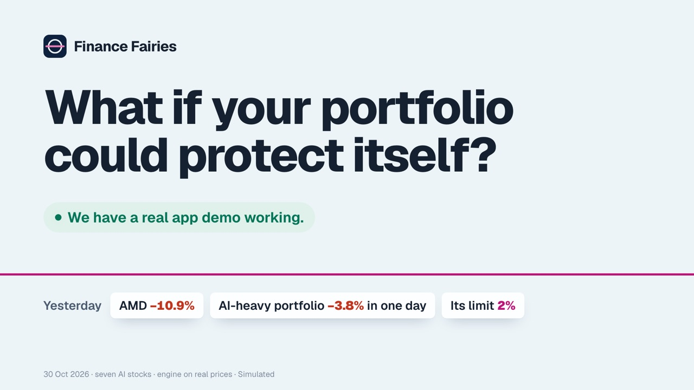 1 · Hook</td><td width="50%">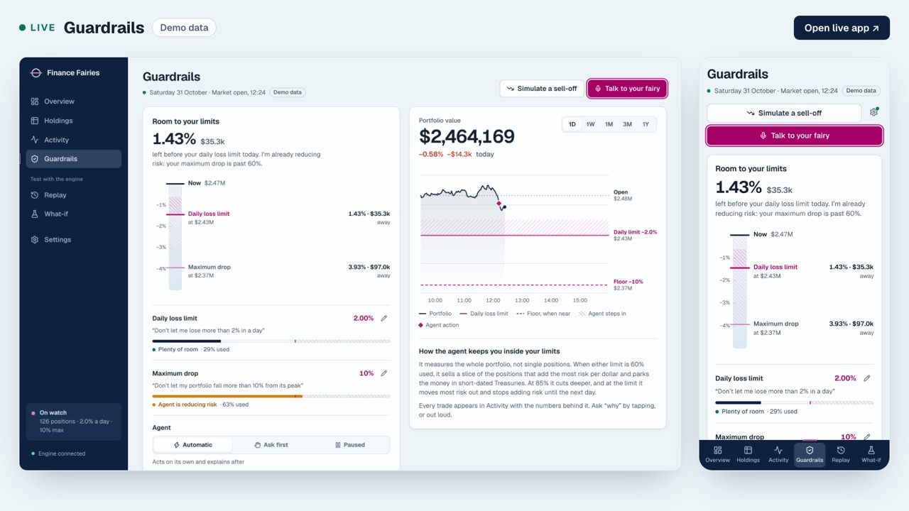 2 · Meet Alex's fairy (live)</td></tr>
<tr><td width="50%">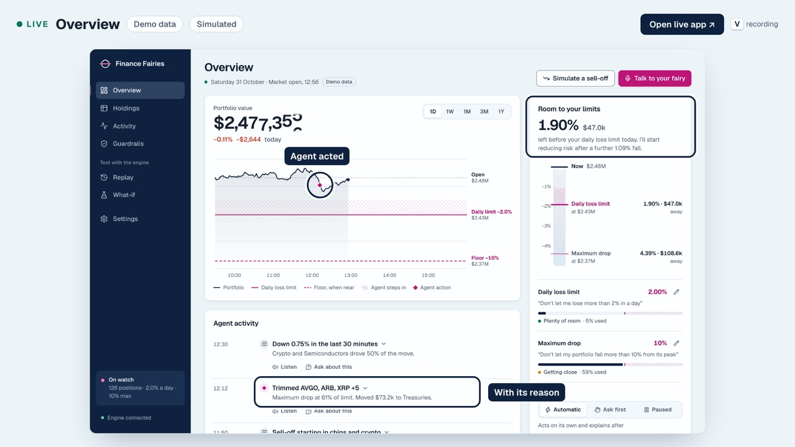 3 · The crash (live)</td><td width="50%">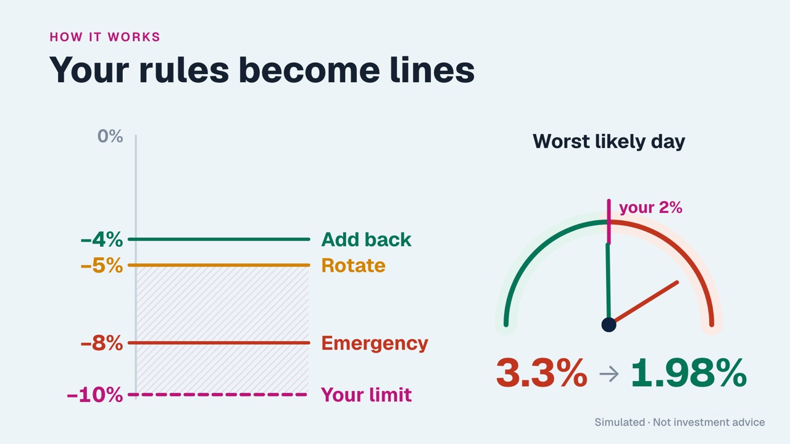 4 · Rules become lines</td></tr>
<tr><td width="50%">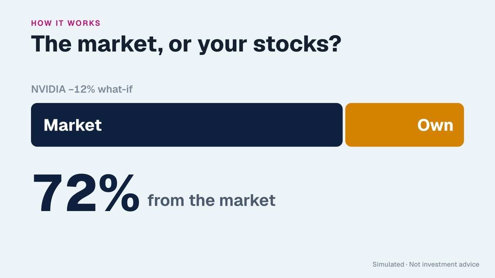 5 · Market or your stocks?</td><td width="50%">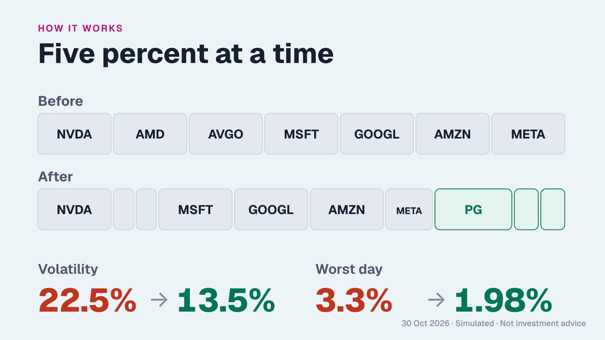 6 · Five percent at a time</td></tr>
<tr><td width="50%">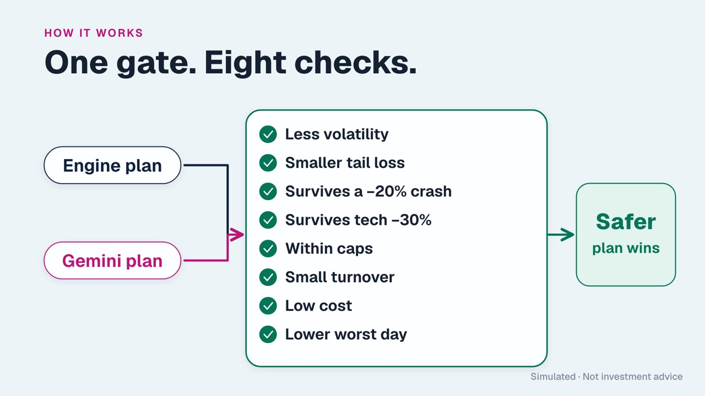 7 · One gate, eight checks</td><td width="50%">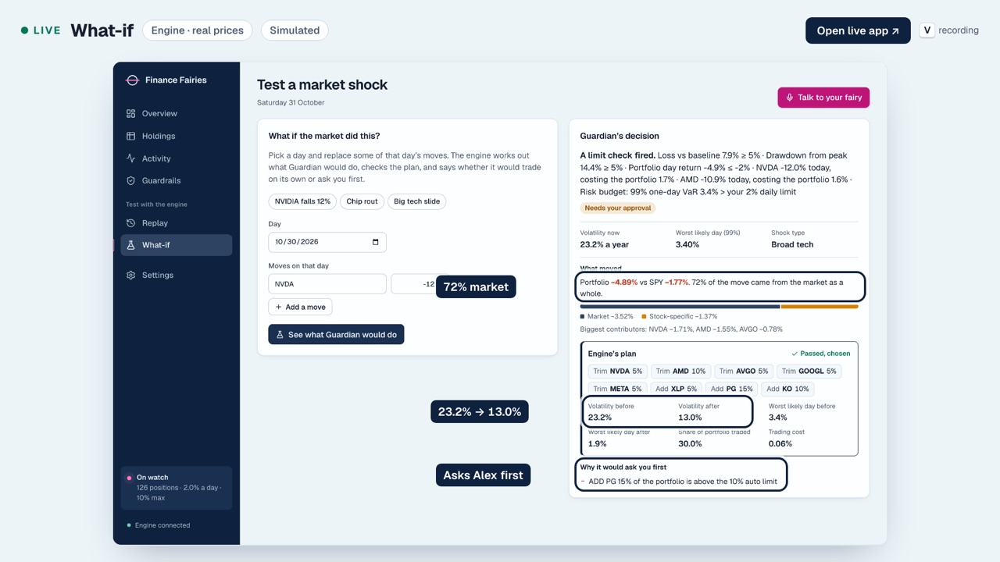 8 · What-if (live)</td></tr>
<tr><td width="50%">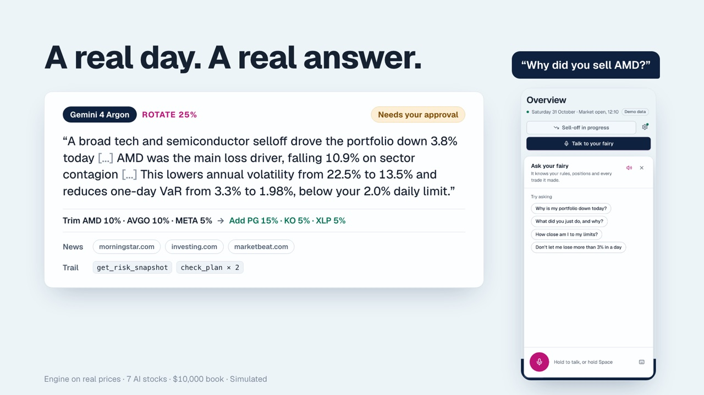 9 · A real day, a real answer</td><td width="50%">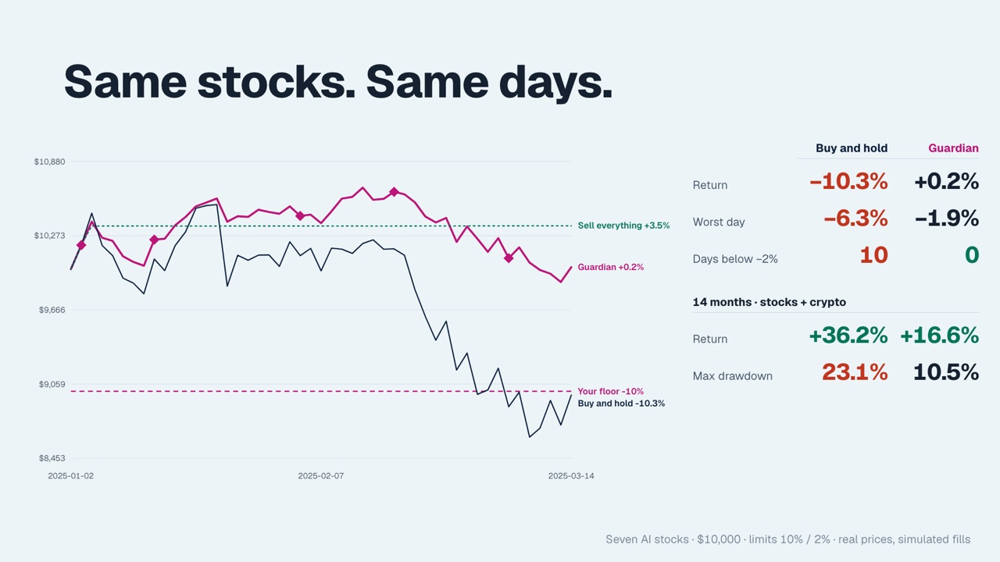 10 · Proof</td></tr>
<tr><td width="50%">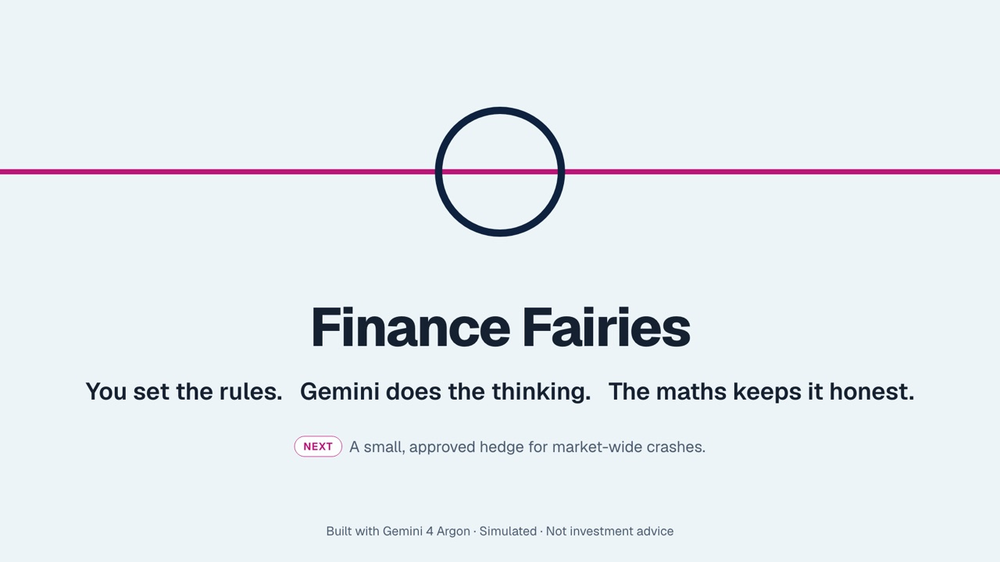 11 · Close</td></tr>
</table>
